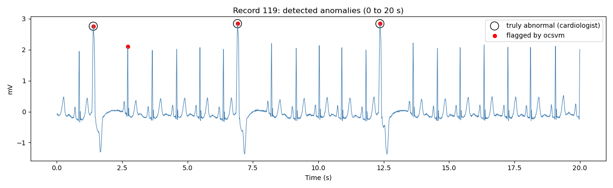
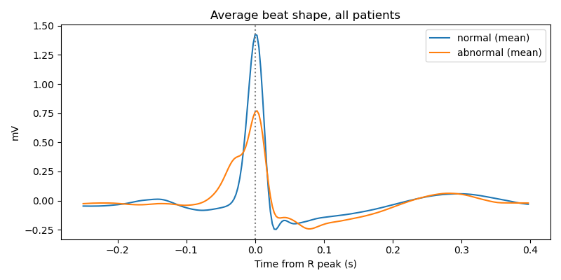
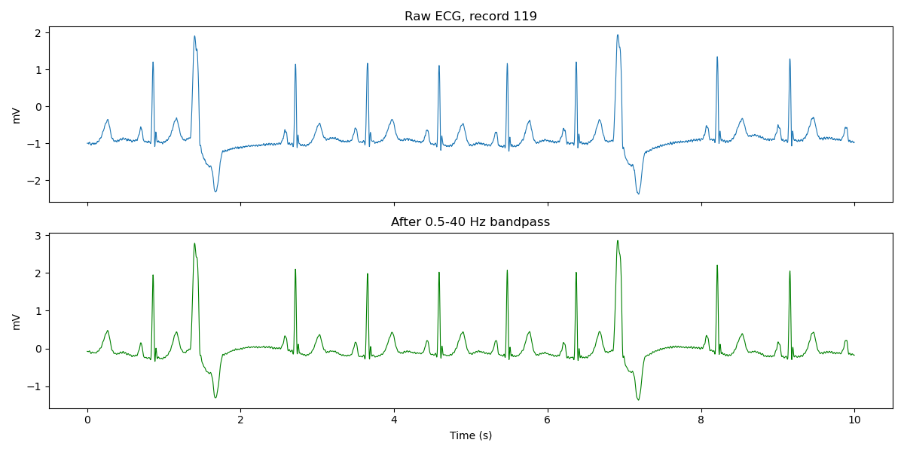

# Anomaly Detection in Non-Stationary ECG Signals

Course project for Machine Learning for Signal Processing (MLSP), JIIT Noida.
Detects abnormal heartbeats in ECG recordings with unsupervised anomaly detection (Isolation Forest, One-Class SVM, Local Outlier Factor) and studies how per-patient feature normalization helps when the signal is non-stationary.

## The problem

An ECG changes over time and from patient to patient: the baseline drifts, heart rate varies, and one patient's normal beat can look like another patient's abnormal one. A model trained with one global set of statistics tends to confuse ordinary variation with true abnormality.

**Question studied:** how should beat features be normalized so that an anomaly detector works on patients it has never seen?

## Dataset

[MIT-BIH Arrhythmia Database](https://physionet.org/content/mitdb/1.0.0/) (PhysioNet): 48 half-hour two-lead recordings at 360 Hz with cardiologist beat annotations.

- 44 records used (the 4 paced records 102, 104, 107, 217 are excluded)
- Lead MLII, picked by name (record 114 stores its leads in the opposite order)
- 100,680 beats: 90,089 normal and 10,591 abnormal (10.5%)
- Normal: N, L, R, e, j. Abnormal: A, a, J, S, V, F, E

## Method

1. **Bandpass filter** (signal processing technique 1): 4th-order Butterworth, 0.5 to 40 Hz, zero-phase so R peaks do not move.
2. **Beat segmentation:** 0.25 s before to 0.40 s after each R peak.
3. **Features** (signal processing technique 2):
   - 8 time-domain shape statistics
   - 6 wavelet features (db4, 4 levels, relative band energy plus log total energy)
   - 3 RR-interval features (previous RR, next RR, previous RR relative to the recent mean)
4. **Adaptive normalization** (the research part): per-patient median and IQR taken either from a fixed calibration window (the first 300 beats) or from a sliding window (the previous 300 beats), compared with plain global scaling. No labels are used.
5. **Models:** Isolation Forest, One-Class SVM, LOF, each fit on normal beats only.
6. **Evaluation:** patient-wise 5-fold cross-validation (test patients are never seen in training). The decision threshold is the 95th percentile of scores on held-out normal training beats. Metrics: precision, recall, F1, ROC-AUC, average precision.

## Main results

Sliding-window normalization makes shape features better and much more stable across patients (Isolation Forest, time-domain features):

| Normalization | AUC | F1 | F1 std across folds |
| --- | --- | --- | --- |
| Global | 0.779 | 0.390 | 0.166 |
| Calibration (fixed) | 0.778 | 0.391 | 0.217 |
| Sliding window | 0.814 | 0.469 | 0.046 |

RR features are already relative to the patient's recent rhythm and work best left unnormalized. The best setup normalizes the shape features and keeps RR raw:

| Model | AUC | F1 |
| --- | --- | --- |
| One-Class SVM | 0.902 | 0.572 |
| LOF | 0.905 | 0.567 |
| Isolation Forest | 0.877 | 0.507 |

Wavelet features added nothing across patients. Isolation Forest was the most conservative detector (it misses more abnormal beats), so it was not the best model here. Full tables for every experiment are in the course report (not included in this repo).

## Demo

`python AnomalyDetection.py --demo 119 --model ocsvm` trains on the normal beats of all other patients, runs on record 119 and plots the detections against the cardiologist labels. On record 119 it catches 425 of 444 abnormal beats with 7 false alarms. Record 119 is an easy patient, so treat these numbers as an illustration, not as overall performance.

## Figures

**Detections on record 119** (black circles: cardiologist labels, red dots: flagged by One-Class SVM)



**Average beat shape, normal vs abnormal**



**Effect of the 0.5 to 40 Hz bandpass filter**



## Project structure

```
AnomalyDetection.py   main script: pipeline, experiments and demo
requirements.txt      Python packages
figures/              images used in this README
```

## How to run

```
pip install -r requirements.txt

python AnomalyDetection.py                                  # figures and demo on record 119
python AnomalyDetection.py --plots                          # filtering and mean-beat figures
python AnomalyDetection.py --experiments features           # feature-set comparison
python AnomalyDetection.py --experiments normalization      # global vs calibration vs sliding
python AnomalyDetection.py --experiments models             # three models, five feature sets
python AnomalyDetection.py --demo 119 --model iforest       # demo with Isolation Forest
```

The dataset is read from a local folder `mitdb_local` if it exists. Otherwise it is streamed from PhysioNet. To download it once:

```
python -c "import wfdb; wfdb.dl_database('mitdb', 'mitdb_local')"
```

Beats are cached in `beats_cache_v2.npz` after the first run. Delete that file if you change the window or the labels.

## Limitations

- The hybrid setup (normalize shape features, keep RR raw) was chosen after seeing earlier results, and the same folds were reused, so the best scores are probably slightly optimistic.
- Only five folds: F1 differences below about 0.03 are noise.
- No hyperparameter tuning for any model.
- One lead and one database. The normal and abnormal grouping is a modelling choice (bundle branch block beats count as normal).
